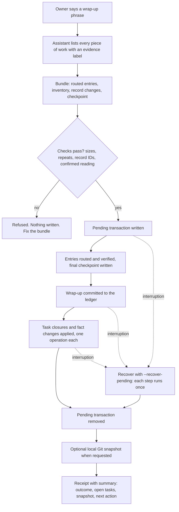

# Work lifecycle

This page explains how Aham Brahmasmi keeps work recoverable without tying the Brain to one model or terminal.

## Starting work

There are two ways to start, and the owner's phrase chooses between them.

| | Quick start | Regular start |
| --- | --- | --- |
| Reads | Standing files and active facts | The same, plus open tasks, lessons, the latest checkpoint and the last session |
| Byte ceiling | `quick_budget_bytes` in `core/startup.json` | `startup_budget_bytes` in the workspace `INDEX.json` |
| Can save or wrap up | No | Yes, after the reading is confirmed |
| Used when | No phrase was said, or the owner asks for it | The owner asks for it, or an upgrade condition applies |

With no phrase, the assistant starts Quick. It upgrades to Regular, and says so, when
the owner asks to resume earlier work, asks about tasks, earlier sessions or lessons,
before any save or wrap-up, or when a pending recovery exists.

What the assistant reads is a packet built from the operation ledger, not the
Markdown files. `MEMORY.md`, `TODO.md` and `LESSONS.md` remain a readable record for
the owner, but a completed task or a replaced fact no longer appears at startup, and
those files can grow without affecting the startup budget. When the content cannot
fit, the packet drops the last session first, then the oldest lessons, then the oldest
facts, shortens tasks before dropping any, and reports what it left out. Standing
files are always delivered whole.

```text
python3 aham.py start --workspace <workspace> --runtime <runtime> --mode quick
python3 aham.py context --startup --workspace <workspace>
python3 aham.py context --startup --workspace <workspace> --part 1
python3 aham.py confirm-context --workspace <workspace> --session-id <id> --part-digest <part_sha256>
```

The second command lists the parts and their sizes. Each part is read with `--part N`
and carries a `part_sha256`. `confirm-context` takes one `--part-digest` per part and
prints `CONTEXT CONFIRMED` when every part was presented, or names the missing part
numbers. Until then the session cannot save or wrap up; recovery commands still work.
This is reported reading coverage as defined in `docs/EVIDENCE_SEMANTICS.md`, not
proof of comprehension. An upgrade with `start --mode regular --upgrade-from
<quick-session-id>` keeps the parts the Quick session already confirmed.

When the workspace has Git history that tracks an upstream, `state_freshness` in the
startup report says how the workspace compares with the upstream ref stored on this
machine. If it is behind or diverged, a Regular start still serves the packet but
allows no save or wrap-up until the owner brings the workspace up to date. See
`docs/GIT_TRANSPORT.md`.

For a normal session, first verify the private workspace.

If `state/pending_wrap_up.json` exists, do not start new work yet. Finish that interrupted wrap-up first.

If a durable checkpoint already exists, verify it before relying on it:

```text
python3 scripts/resume.py --workspace <workspace>
```

If the checkpoint recorded Git repository state, also provide the project repository:

```text
python3 scripts/resume.py --workspace <workspace> --repo <project-repository>
```

Recovery verifies the workspace identity. When Git state was recorded, it also verifies the branch and confirms that the checkpoint commit is still part of the current history.

## Owner phrases

The owner chooses the words that request each routine. Defaults are `regular start`,
`quick start`, and `wrap up` or `done for the day`. The startup report's `owner_phrases` field and the
read-only command below show the current choice:

```text
python3 aham.py phrases list --workspace <workspace>
```

The owner can replace a routine's phrases (up to five each, at most 40 characters,
letters, digits, spaces, apostrophes and hyphens; one phrase cannot name two routines):

```text
python3 aham.py phrases set --workspace <workspace> --wrap-up "wrap up" --wrap-up "end of day" --confirm set-phrases
```

Each change is an immutable `phrase_control` record in the private workspace, so it
survives export, restore and assistant switches. Phrases name existing routines only.
They grant no permissions, and the controller never reads chat messages: the
assistant recognizes the phrase and runs the routine. A Quick start is read-only
whichever phrase requested it.

Like `trust-runtime`, `phrases set` issues its own owner session, which replaces the
assistant's current session ID. Run `start` again after changing phrases.

## Saving a milestone

After a meaningful completed milestone, save a checkpoint:

```text
python3 scripts/checkpoint.py \
  --workspace <workspace> \
  --summary "What was actually completed" \
  --completed "Verified completed item" \
  --next-step "Next verified step"
```

When the task belongs to a Git repository, add:

```text
--repo <project-repository>
```

The checkpoint stores the repository name, branch and commit, not the local absolute repository path.

Only verified completed work belongs under `--completed`. Do not record an intended action as if it already happened.

## Wrapping up a session

When the owner says one of their wrap-up phrases (by default `wrap up`), the assistant should classify durable session information into:

- durable facts;
- unfinished work;
- reusable lessons;
- project-specific updates;
- dated history;
- a final checkpoint.

The assistant then creates a temporary JSON bundle in the private workspace, not in the public framework repository. The shape is:

```json
{
  "session_id": "optional-stable-session-name",
  "durable_facts": ["A fact worth remembering"],
  "unfinished_work": ["A task that remains open"],
  "reusable_lessons": ["A lesson worth reusing"],
  "project_updates": [
    {
      "project": "Example Project",
      "content": "Project-specific state"
    }
  ],
  "history": ["A meaningful outcome from this session"],
  "checkpoint": {
    "summary": "Where the session ended",
    "completed": ["Verified completed work"],
    "next_steps": ["Where to continue"],
    "artifacts": ["Relevant commit, PR or file reference"],
    "project": "Example Project"
  }
}
```

Run:

```text
python3 scripts/wrap_up.py --workspace <workspace> --bundle <bundle-file>
```

Add `--repo <project-repository>` when repository state should be captured.

After a successful wrap-up, the temporary input bundle can be removed. The normalized completed transaction is already archived under `state/wrapups/`.

### Inventory, evidence labels and record changes

A bundle may also carry an `inventory` and `lifecycle`. The inventory lists every
independent piece of work from the whole session, not only the last topic. A
suggestion that was not carried out is not work.

```json
{
  "durable_facts": ["The export job runs nightly at 02:00."],
  "unfinished_work": ["Add retry handling to the export job."],
  "inventory": [
    {
      "id": "export-schedule",
      "summary": "Moved the export job to a nightly schedule",
      "evidence_status": "verified",
      "evidence": "Scheduler listing shows the 02:00 entry; a manual run succeeded.",
      "next_action": null,
      "routes": [{"field": "durable_facts", "index": 0}],
      "nothing_durable_reason": null
    },
    {
      "id": "export-retries",
      "summary": "Discussed retry handling; not implemented",
      "evidence_status": "not_done",
      "evidence": "",
      "next_action": "Implement retries and test a forced failure.",
      "routes": [{"field": "unfinished_work", "index": 0}],
      "nothing_durable_reason": null
    }
  ],
  "lifecycle": [
    {"action": "task_complete", "id": "task_...", "reason": "Schedule verified.", "item": "export-schedule"}
  ],
  "checkpoint": {"summary": "Export job scheduled", "next_steps": ["Implement retries."]}
}
```

- `evidence_status` is one of `verified`, `owner_reported`, `inferred`, `unverified` or `not_done`. `verified` and `owner_reported` must say what the evidence is.
- Every entry in the five routed lists must belong to exactly one item, and an item that routes nothing gives a `nothing_durable_reason` unless a record change names it.
- With an inventory, do not supply `checkpoint.completed`: it is taken from the summaries of the `verified` items.
- `lifecycle` changes existing records by the IDs shown in the startup packet: `task_complete`, `task_cancel`, `fact_supersede` (with `replacement`) and `fact_retract`. A task is completed only on an item marked `verified`; otherwise it stays open.
- A new wrap-up is refused, before anything is written, when an entry exceeds its size cap (`wrap_up.item_caps_bytes` in `core/lifecycle.json`), repeats an active fact or open task of the same projects, or names a record that does not exist or is already closed. The message names the entry or the existing ID.

`aham.py tasks list` and `aham.py facts list` show the records and their IDs.

### How a wrap-up runs



### What five kinds of session produce

| Session | Routed entries | Inventory | Record changes | Checkpoint completed |
| --- | --- | --- | --- | --- |
| New project started | A project update, facts about its setup, tasks for what is next | One item per piece of setup, `verified` where checked | None | Summaries of the verified items |
| Work on an existing project | Project update, new facts, history | One item per piece of work | `fact_supersede` for anything that changed | Summaries of the verified items |
| A task verified and closed | History entry | One `verified` item with its evidence | `task_complete` naming that item | That item's summary |
| Work done but not verified | A task describing the check still needed | One `unverified` item with a next action | None; the task stays open | Empty |
| Discussion only | None | One `not_done` item with a `nothing_durable_reason` | None | Empty |

### What the receipt reports

The receipt ends with a summary: `Outcome`, what was routed, tasks completed and still
open, each record change, the Git snapshot status, whether a copy exists beyond this
machine as far as the local upstream ref shows, and the next action. `--snapshot`
takes a local Git snapshot after the wrap-up is committed; it never pushes. When the
outcome is `blocked`, the wrap-up is not finished and the next action says how to
recover it.

## If wrap-up is interrupted or fails

Aham Brahmasmi writes `state/pending_wrap_up.json` before routing durable state. Before each replay-safe stage, it also records the current step and useful detail in the transaction's `progress` field.

If a later operation fails, the command preserves the pending transaction and reports:

- the original error;
- the remaining wrap-up step;
- step detail when available;
- the recovery command to run.

For example, a failure while persisting a project update reports `route_projects` rather than merely saying that wrap-up failed.

Replay the preserved transaction with:

```text
python3 scripts/wrap_up.py --workspace <workspace> --recover-pending
```

If the transaction recorded Git state, provide `--repo` again.

Routed entries carry stable internal markers, so replaying the same transaction does not duplicate entries already written before the interruption. Progress is recorded before each stage so it remains useful even when the stage itself is the part that fails.

The tracked stages include repository verification, transaction validation, routing memory/tasks/lessons/projects/history, routed-state verification, final checkpoint creation, transaction archival, each task closure or fact change (`apply_lifecycle`) and pending-transaction removal. Record changes are applied after the wrap-up itself is committed; recovery skips any that already committed, so each is applied exactly once.

## What these scripts do not do yet

They do not automatically decide when a milestone has occurred. Runtime adapters still need to invoke checkpointing during long work and call wrap-up when the user requests it.

MemPalace is optional and is not required for any command on this page.
